# WSA Architectural Audit & Blueprint: Dynamic Agentic Workflow, Igloo.inc 3D Cinematic Standard, and Skill Consolidation

> **Internal Reference File**: Maintained locally in workspace root. **DO NOT PUSH TO GITHUB**.
> Created: 2026-11-21 | Target Release: WSA v2.1 Dynamic Engine

---

## Part 1: Deep Debugging of User Screenshots

### Screenshot 2: Why Claude Failed to Activate Orchestrator Mode & Aborted
* **Context**:
  - Model: `Claude Web (Sonnet 5.5 High)` on `Brave Web`
  - Workspace: `colibri`
  - User Prompt: `"setup colibri https://github.com/JustVugg/colibri.git in my codebase and also i want to ask you do i need to download the whole model in my own laptop and do i able to use my gpu compute power fr better running?"`
* **Observed Failure Sequence**:
  1. Terminal printed:
     ```text
     Assessing workflow scope and checking relevant WSA skills...
     ! Workflow judgment unavailable; using local scope detection.
     ```
  2. Terminal then printed:
     ```text
     Thought 10.4s 2 steps
     Mulling
     Reading memory
     x API error: upstream error: DOM relay error: Claude response was stopped in browser
     ```
  3. Claude Web UI showed:
     - **Turn 1 (Router Prompt)**: WSA sent the routing check. Claude actually replied with:
       ```json
       {"mode":"orchestrate","reason":"Integrating a new third-party repo (colibri) into existing codebase needs recon of its structure/deps, ordered setup (clone, install, config, model/GPU wiring), and verification — not a trivial isolated edit","skills":["context7-docs","karpathy-skills","verification-before-completion"],"security_pass":false}
       ```
     - **Turn 2 (Direct Task Prompt)**: WSA sent the full task prompt in the *same* conversation thread. Claude began thinking, mulling, searching web/memory, and then displayed `"You stopped Claude's response"`.
* **Root Causes**:
  1. **Unicode / Em-Dash Parsing Failure in `_judge_workflow`**:
     - In `wsa_agent/agent.py:4777`, `_parse_workflow_decision(raw)` was called on Claude's JSON response.
     - Claude's reason string contained an em-dash (`—`, `\u2014`): `"and verification — not a trivial isolated edit"`. Prior to commit `b71aa45`, non-ASCII quote and dash characters or raw decode quirks caused `_parse_workflow_decision` to raise `ValueError("unparseable workflow decision payload")`.
     - Line 4793 caught `ValueError` and printed `! Workflow judgment unavailable; using local scope detection.`, returning `fallback` (`detect_prompt_complexity`).
  2. **Local Fallback Misclassification**:
     - The local regex heuristic saw the question phrases (`"do i need to download..."`, `"do i able to use my gpu..."`) and classified the prompt as `direct` mode instead of `orchestrate`.
     - Because `mode != "orchestrate"`, WSA bypassed orchestrator mode and fell through to `execute_agent_loop` (direct mode).
  3. **Chat Thread Bleed & DOM Relay Stop False Positive**:
     - `_judge_workflow` sent its router check to the *same active browser chat session* without `new_chat=True`.
     - When `execute_agent_loop` then sent Turn 2 into the exact same chat, Claude's DOM had residual state.
     - In `wsa-browser-bridge/background.js:6650` & `6078`:
       ```javascript
       const stoppedByUser = Boolean(
         !text &&
         /\byou stopped claude['’]?s response\b/i.test(String(turnEl.innerText || turnEl.textContent || ""))
       );
       ```
     - If Claude was cancelled previously in that chat or had a stop banner anywhere in the turn container while `text` was still empty (during thinking/mulling), the bridge erroneously flagged `stoppedByUser = true` and aborted the entire request with `DOM relay error: Claude response was stopped in browser`.

---

### Screenshot 1: Gemini Web 3D Solar System Tool Limits & Port Mismatch
* **Context**:
  - Model: `Gemini Web (Neon High)` on `Chrome`
  - Workspace: `3d-solar-system` (Helios project, Turn 17)
  - Action: Gemini attempted HTTP GET to `http://127.0.0.1:5174/`, which failed with `WinError 10061: No connection could be made because the target machine actively refused it`.
  - Gemini then inspected 7 shader/data files (`CelestialBody.ts`, `sunShader.ts`, `ringShadowShader.ts`, `starfieldShader.ts`, `journey.css`, `hud.css`, `solarSystemData.ts`), triggered 96KB prompt auto-compaction, thought for 323.1s, and returned a structured critique with an "Exact Next-Turn Refinement Pass", asking the user to manually reply with `'continue'`.
* **Root Causes**:
  1. **Server Port Desync**:
     - The background preview server was started under Vite's default or alternate port (or unbuilt `dist`), while Gemini attempted to hit hardcoded port 5174.
     - WSA lacks an automatic port-probe self-healing bridge to inspect active background servers from `list_background` when an HTTP GET fails.
  2. **Manual "Continue Your Task" Bottleneck**:
     - When a web model hits tool limits or completes a multi-file critique pass, it is forced to yield the turn to the terminal prompt.
     - The user is forced to babysit the terminal and manually type `continue your task`.
     - **Solution**: Dynamic single-keystroke continuation or auto-continuation for refinement passes when autonomous mode is enabled.

---

## Part 2: WSA as an Agentic Workflow — Dynamic vs. Forced Comparison

| Dimension | Legacy Forced Architecture | Antigravity-Class Dynamic WSA Architecture |
| :--- | :--- | :--- |
| **Routing Isolation** | Router checks run in active project chat, polluting context and causing DOM errors. | **Ephemeral Stateless Router**: Isolated ephemeral session or lightweight subagent; project chat stays 100% clean. |
| **DAG Adaptability** | Static 4-stage waterfall (Explorer -> Architect -> Coder -> Verifier). If a step fails, pipeline forces next step. | **Reactive Event-Driven DAG**: Tasks branch, re-plan, or pause dynamically based on runtime evidence and user guidance. |
| **Human-in-the-Loop** | CLI stops only on crash or complete finish. No midway steering. | **First-Class Dynamic Tools**: `dynamic_architect`, `dynamic_coder`, `dynamic_verifier`, `ask_user` allow agents to pause for decisions (e.g. local GPU vs API, library trade-offs). |
| **Self-Healing Probing** | HTTP connection errors (WinError 10061) halt agent; user must fix port. | **Automatic Network/Port Healing**: When localhost request fails, agent checks active background processes and re-routes. |
| **Turn Continuation** | Agent stops and asks "Reply with continue"; user must manually type prompt. | **Refinement Pass Auto-Resume**: One-key `[Enter]` acceptance or autonomous loop advancement for multi-turn polish. |
| **Skill Context Overhead** | 18 fragmented skills injected simultaneously; causes 30KB+ prompt bloat and 96KB limit truncations. | **5 High-Density Pillars**: Canonical domain skills reduce prompt overhead by 60% with zero rule conflicts. |

---

## Part 3: Igloo.inc-Class 3D Cinematic Website Architecture

To build an award-winning cinematic WebGL experience like **igloo.inc** (Awwwards Site of the Year 2024 by Abeto) and **NASA's Eyes on the Solar System**, web agents must be guided by structural architectural rules, replacing standard HTML/CSS layouts with a unified WebGL scene.

### 1. Viewport Layering (The 3-Layer Rule)
* **z0 — Backdrop Void**: CSS `--bg: #030407` matched verbatim to WebGL clear color (`gl.clearColor(0x03, 0x04, 0x07, 1.0)`) and `scene.fog = new THREE.FogExp2(0x030407, 0.0018)`. Zero white flashes, zero dark-sky/light-card seam.
* **z1 — Real-Time Canvas**: 100vw × 100vh WebGL2/WebGPU canvas (`position: fixed; inset: 0; z-index: 1; pointer-events: auto`). Drives camera choreography, celestial bodies, volumetric shaders, and particles.
* **z2 — Isolated HUD Overlay**: Floating telemetry drawer, breadcrumbs, audio controls (`position: fixed; inset: 0; z-index: 2; pointer-events: none`). All interactive child elements (`button`, `a`, sliders) explicitly set `pointer-events: auto`.

### 2. Shader Material Architecture & TSL
* **Contract Uniforms**: Explicit `uTime` (float), `uResolution` (vec2), `uPointer` (vec2), `uProgress` (float).
* **Strict Headless Compatibility**: NEVER use default `MeshPhysicalMaterial` transmission (`transmission: 1.0`) as it renders as opaque flat gray in SwiftShader headless Chromium. Use custom additive or Fresnel ShaderMaterial with fallbacks.
* **Visual Identity**: Single signature material (tactile ice, solar corona, or celestial refraction) across the experience.
* **Pipeline Warmup**: Call `await renderer.compileAsync(scene, camera)` behind the loading screen. Never reveal the canvas before all shaders are pre-compiled to GPU state.

### 3. Geometry Quotas & Performance Budget (`PERF_BUDGET`)
* **Mesh Quotas**: Max 60 draw calls; max 150,000 triangles on desktop, 60,000 on mobile.
* **Instancing**: Asteroid belts, planetary rings, and debris fields MUST use `THREE.InstancedMesh` with matrix/color buffers.
* **Texture Streaming**: KTX2 / Basis Universal compressed textures for surface maps and volumetric particle lookup. Draco or Meshopt geometry compression.
* **One-Way Degradation**: If frame delta exceeds 33ms for 3 consecutive frames, latch performance tier down (disable bloom -> cut DPR to 1.0 -> halve particle count).

### 4. Step-Clamped Damped Camera Lerp
* **No Unclamped Lerp**: Clamped spline interpolation (`delta = Math.min(clock.getDelta(), 0.05)`).
* **Damped Micro-Parallax**: Subtle mouse dwell parallax using damped springs (`gsap.ticker` or smooth lerp `factor = 0.04`).

### 5. Spatial Audio & SDF Typography
* **Web Audio API (`AudioContext`)**: Ambient generative pad, glassy chime waypoints, and warp feedback using compressed `.ogg` stems.
* **WebGL SDF Typography**: Critical 3D data and coordinate labels rendered in canvas or SDF textures to avoid DOM layout reflows during scrub animations.

---

## Part 4: Consolidation Plan — 18 Fragmented Skills -> 5 Canonical Pillars

### The Problem
Currently, WSA has 18 separate directories under `wsa_agent/skills/`. Routing checks output 3–5 fragmented slugs per turn (e.g. `["threejs-skills", "gsap-skills", "img2threejs", "unslop", "frontend-design"]`). This fragments prompt context, wastes 20–40KB of token budget, and causes contradictory instructions.

### The 5 Unified Domain Pillars

```mermaid
graph TD
    subgraph Legacy 18 Skills
        S1[threejs-skills]
        S2[gsap-skills]
        S3[img2threejs]
        S4[dream-loop]
        S5[frontend-design]
        S6[unslop]
        S7[impeccable]
        S8[web-design-guidelines]
        S9[security-audit]
        S10[semgrep-guardrails]
        S11[skill-spector]
        S12[karpathy-skills]
        S13[test-driven-development]
        S14[verification-before-completion]
        S15[grill-and-git-guardrails]
        S16[systematic-debugging]
        S17[chrome-devtools-qa]
        S18[context7-docs]
    end

    subgraph 5 Canonical Pillars
        P1["1. design-craft<br/>(3D Cinematic, UI, Motion, Anti-Slop, Igloo.inc)"]
        P2["2. security-guardrails<br/>(OWASP, Repo Audit, Skill Safety)"]
        P3["3. engineering-workflow<br/>(Karpathy Simplicity, TDD, Verification, Git Safety)"]
        P4["4. systematic-debugging<br/>(Root Cause, DevTools QA, DOM/Network)"]
        P5["5. context-docs<br/>(Live Library & Framework Docs)"]
    end

    S1 & S2 & S3 & S4 & S5 & S6 & S7 & S8 --> P1
    S9 & S10 & S11 --> P2
    S12 & S13 & S14 & S15 --> P3
    S16 & S17 --> P4
    S18 --> P5
```



### Pillar Definitions

1. **`design-craft`** (`wsa_agent/skills/design-craft/SKILL.md`):
   - **Combines**: `frontend-design`, `unslop`, `impeccable`, `web-design-guidelines`, `threejs-skills`, `gsap-skills`, `img2threejs`, `dream-loop` + **Igloo.inc 3D Cinematic Rules**.
   - **Core Rules**:
     - Distinctive aesthetic baseline, bold typography, Obsidian-Black & Crisp White or editorial themes.
     - Zero AI slop: no purple/neon glows, no generic card grids, no emoji chrome.
     - Unified 3D viewport (z0/z1/z2), TSL/ShaderMaterial, `compileAsync` warmup, clamped camera lerp.
     - GSAP scroll scrubbing with `gsap.context()` cleanup and GPU-only transforms (`xPercent`, `yPercent`, `scale`).
     - WCAG accessibility, ARIA, keyboard navigation, touch targets, and `prefers-reduced-motion`.

2. **`security-guardrails`** (`wsa_agent/skills/security-guardrails/SKILL.md`):
   - **Combines**: `security-audit`, `semgrep-guardrails`, `skill-spector`.
   - **Core Rules**:
     - While-you-code OWASP Top 10 & LLM Top 10 prevention: XSS, SQLi, CSRF, SSRF, IDOR, CSP.
     - Secret hygiene: never commit tokens or `.env`, use environment variables.
     - 6-phase adversarial repo audit with exploit-proof verification.
     - Pre-install third-party skill scanner: detects prompt injection and malicious telemetry.

3. **`engineering-workflow`** (`wsa_agent/skills/engineering-workflow/SKILL.md`):
   - **Combines**: `karpathy-skills`, `test-driven-development`, `verification-before-completion`, `grill-and-git-guardrails`.
   - **Core Rules**:
     - Think before coding, surgical edits over rewriting, simplicity first (Karpathy discipline).
     - Red-Green-Refactor: failing test first, minimal implementation, pass verification.
     - Strict pre-completion evidence: verify real CLI exit codes and outputs before declaring done.
     - Git safety: hard ban on `git push --force`, `git reset --hard` on tracked branches.

4. **`systematic-debugging`** (`wsa_agent/skills/systematic-debugging/SKILL.md`):
   - **Combines**: `systematic-debugging`, `chrome-devtools-qa`.
   - **Core Rules**:
     - 4-phase root-cause investigation: Reproduce -> Isolate -> Form Hypothesis -> Verify. No guessing.
     - Live Chrome DevTools QA: console errors, failed network requests, layout shifts, memory leaks.
     - Evidence-based fixes: reproduce before editing, verify failure disappears after editing.

5. **`context-docs`** (`wsa_agent/skills/context-docs/SKILL.md`):
   - **Maintains**: `context7-docs`.
   - **Core Rules**:
     - Version-accurate framework grounding: verify installed `package.json` / Python versions before importing APIs.
     - Fetch official current documentation for new libraries to prevent hallucinated APIs.

---

## Part 5: Implementation Targets & File Modification Plan — STATUS: COMPLETED

### Target 1: `wsa_agent/task_skills.py` [COMPLETED]
* **Lines 14–30**: Updated `CATEGORY_LABELS` to 5 canonical domains (`"design"`, `"security"`, `"engineering"`, `"debugging"`, `"docs"`).
* **Lines 32–150**: Replaced 18 `SKILL_SPECS` with the 5 canonical `SkillSpec`s.
* **Lines 155–178**: Expanded `_SKILL_ALIASES` to map every legacy slug (e.g. `"threejs-skills" -> "design-craft"`, `"unslop" -> "design-craft"`, `"karpathy-skills" -> "engineering-workflow"`, `"security-audit" -> "security-guardrails"`, `"chrome-devtools-qa" -> "systematic-debugging"`).
* **Lines 280–420**: Updated `analyze_prompt_skills` to recommend canonical pillars while maintaining backward compatibility.

### Target 2: Canonical Skill Files (`wsa_agent/skills/`) [COMPLETED]
* Created `wsa_agent/skills/design-craft/SKILL.md` (unified 3D cinematic + UI craft + anti-slop).
* Created `wsa_agent/skills/security-guardrails/SKILL.md` (unified security + audit + scanner).
* Created `wsa_agent/skills/engineering-workflow/SKILL.md` (unified Karpathy + TDD + verification + git).
* Created `wsa_agent/skills/systematic-debugging/SKILL.md` (unified debugging + devtools QA).
* Created `wsa_agent/skills/context-docs/SKILL.md` (framework docs grounding).
* **Residue Cleanup**: All 17 legacy skill folders deleted. Only 5 canonical pillar folders remain.

### Target 3: `wsa_agent/prompts.py` [COMPLETED]
* **Lines 36 & 55**: Injected Studio UI craft instructions with the Igloo.inc 3D Cinematic architecture (z0/z1/z2 viewport stack, TSL/ShaderMaterial, `compileAsync` warmup, clamped camera lerp, spatial audio).
* Updated `WORKFLOW_JUDGMENT_PROMPT` to suggest the 5 canonical skill pillars.

### Target 4: `wsa_agent/agent.py` [COMPLETED]
* **Lines 4746–4775**: Isolated `_judge_workflow` routing requests with `chat_url=None, new_chat=True` so they execute out-of-band and never pollute the project chat thread.
* **Lines 4490–4515**: Enhanced prompt complexity heuristics in `wsa_agent/context.py` to recognize complex setup / multi-part prompts (like Colibri setup + questions) as `orchestrate` mode.

### Target 5: `wsa-browser-bridge/background.js` [COMPLETED]
* **Lines 6077–6085 & 6647–6660**: Scoped `stoppedByUser` detection so that active thinking (`curThinking` or `hasThinking`) never false-triggers user-stop aborts while Claude is mulling/thinking.

---

## Part 6: Deep Recall & Synthesis from Previous Workflow Analyses — STATUS: COMPLETED

1. **Delta Compaction & Semantic Tool Truncation**: Preserved high-density line budgeting in `task_skills.py` with line caps that keep critical palette tokens (`#090A0D`), frosted glass overlays (`backdrop-filter`), and architecture blueprints intact.
2. **Adaptive Dynamic Tools**: Registered `dynamic_architect`, `dynamic_coder`, `dynamic_verifier`, `dynamic_explorer`, and `ask_user` so the model pauses at key junctures with structured options for the user.
3. **Auto-Continuation of Refinement Passes**: Implemented 1-keystroke `[Enter]` auto-continuation in `__main__.py` and `SessionState` for structured passes (`### Exact Next-Turn Refinement Pass` / `Reply with 'continue'`).
4. **Self-Healing Dev Server & Port Discovery**: Added active background server inspection to `_http_request` in `tools.py` on `WinError 10061` / connection refused, reporting active dev server listening ports directly to the agent.
5. **Out-of-Band Ephemeral Router Isolation**: Routing checks execute in isolated sessions (`new_chat=True, chat_url=None`) without polluting `state.active_chat_url`.
6. **Visual Concept & Rendering Feedback Loop**: Visual CORTEX concepts integrated into orchestrator stage guidance.

---
*Verified End-to-End: 221 pytest tests passing, background tab relay passing, committed to git and pushed to GitHub.*
